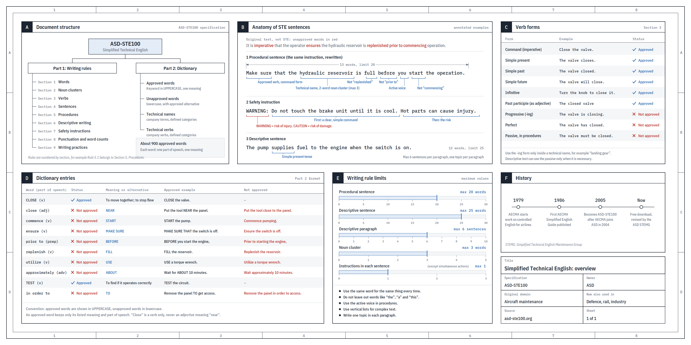

# Karpathy-Inspired Claude Code Guidelines: Build and Explain

> Based on [multica-ai/andrej-karpathy-skills](https://github.com/multica-ai/andrej-karpathy-skills). This version adds a fifth principle from Andrej's [newer post on understanding LLM outputs](https://x.com/karpathy/status/2105819303471976479).

A single `CLAUDE.md` file (also as `AGENTS.md`, and packaged as the `karpathy-build-and-explain` skill) to improve Claude Code behavior, derived from Andrej Karpathy's observations on [LLM coding pitfalls](https://x.com/karpathy/status/2015883857489522876) and on [understanding LLM outputs](https://x.com/karpathy/status/2105819303471976479).

English | [简体中文](./README.zh.md)

## The Problems

From Andrej's first post:

> "The models make wrong assumptions on your behalf and just run along with them without checking. They don't manage their confusion, don't seek clarifications, don't surface inconsistencies, don't present tradeoffs, don't push back when they should."

> "They really like to overcomplicate code and APIs, bloat abstractions, don't clean up dead code... implement a bloated construction over 1000 lines when 100 would do."

> "They still sometimes change/remove comments and code they don't sufficiently understand as side effects, even if orthogonal to the task."

From Andrej's newer post:

> "We'll be spending a lot more time trying to understand the outputs of language models."

As agents do more of the legwork, the human's work moves up to oversight and understanding. Andrej's tips form a ladder, each rung "even better" than the last: plain writing in the controlled language ASD-STE100 (or "80% of the way" to it), then diagrams, then interactive HTML pages, then bespoke explainer videos. Code is now cheap enough that large, custom, discardable artifacts make sense.

## The Solution

Five principles in one file that directly address these issues:

| Principle | Addresses |
|-----------|-----------|
| **Think Before Coding** | Wrong assumptions, hidden confusion, missing tradeoffs |
| **Simplicity First** | Overcomplication, bloated abstractions |
| **Surgical Changes** | Orthogonal edits, touching code you shouldn't |
| **Goal-Driven Execution** | Leverage through tests-first, verifiable success criteria |
| **Explain for Understanding** | Walls of text, results that are hard to read or check, wrong output format |

## The Five Principles in Detail

### 1. Think Before Coding

**Don't assume. Don't hide confusion. Surface tradeoffs.**

LLMs often pick an interpretation silently and run with it. This principle forces explicit reasoning:

- **State assumptions explicitly** — If uncertain, ask rather than guess
- **Present multiple interpretations** — Don't pick silently when ambiguity exists
- **Push back when warranted** — If a simpler approach exists, say so
- **Stop when confused** — Name what's unclear and ask for clarification

### 2. Simplicity First

**Minimum code that solves the problem. Nothing speculative.**

Combat the tendency toward overengineering:

- No features beyond what was asked
- No abstractions for single-use code
- No "flexibility" or "configurability" that wasn't requested
- No error handling for impossible scenarios
- If 200 lines could be 50, rewrite it

**The test:** Would a senior engineer say this is overcomplicated? If yes, simplify.

### 3. Surgical Changes

**Touch only what you must. Clean up only your own mess.**

When editing existing code:

- Don't "improve" adjacent code, comments, or formatting
- Don't refactor things that aren't broken
- Match existing style, even if you'd do it differently
- If you notice unrelated dead code, mention it — don't delete it

When your changes create orphans:

- Remove imports/variables/functions that YOUR changes made unused
- Don't remove pre-existing dead code unless asked

**The test:** Every changed line should trace directly to the user's request.

### 4. Goal-Driven Execution

**Define success criteria. Loop until verified.**

Transform imperative tasks into verifiable goals:

| Instead of... | Transform to... |
|--------------|-----------------|
| "Add validation" | "Write tests for invalid inputs, then make them pass" |
| "Fix the bug" | "Write a test that reproduces it, then make it pass" |
| "Refactor X" | "Ensure tests pass before and after" |

For multi-step tasks, state a brief plan:

```
1. [Step] → verify: [check]
2. [Step] → verify: [check]
3. [Step] → verify: [check]
```

Strong success criteria let the LLM loop independently. Weak criteria ("make it work") require constant clarification.

### 5. Explain for Understanding

**The human must understand your output. Pick the format that makes it easiest to understand.**

Each format is better than the one before it:

| Format | From Andrej's post |
|--------|--------------------|
| 1. Writing | Write in ASD-STE100, or about "80% of the way" to it, because the spec is stringent |
| 2. Diagram | Easier to process, parse, and understand than writing |
| 3. Web page | Output in HTML for a beautiful, interactive page |
| 4. Explainer video | A custom video, for example in 3Blue1Brown style, with TTS narration (ElevenLabs, or a free local alternative) |

Intelligence and code are now abundant, so large, custom, discardable artifacts make sense. These artifacts do not conflict with Simplicity First and Surgical Changes, which govern the code you ship. Keep them out of the codebase unless asked.

Writing rules (from ASD-STE100):

- Procedural sentences at most 20 words, descriptive sentences at most 25
- One instruction in each sentence
- At most 6 sentences in each paragraph, one topic in each paragraph
- Noun clusters at most 3 words
- Imperative and simple tenses; no "is closing" or "has closed"
- Active voice in procedures
- One meaning for each word; the same word for the same thing every time
- Approved words: "use", "start", "make sure", "before" — not "utilize", "commence", "ensure", "prior to"
- Keep "the", "a", and "this"
- Vertical lists for complex text
- Safety instructions: the command first, then the risk



*The ASD-STE100 overview sheet from [Andrej's post](https://x.com/karpathy/status/2105819303471976479). A text copy is in [`skills/karpathy-build-and-explain/references/asd-ste100.md`](skills/karpathy-build-and-explain/references/asd-ste100.md).*

**The test:** Does the user understand your output after one read?

## Install

**Option A: Claude Code Plugin (recommended)**

From within Claude Code, first add the marketplace:
```
/plugin marketplace add zichuanxu/andrej-karpathy-skills
```

Then install the plugin:
```
/plugin install andrej-karpathy-skills@zichuanxu-karpathy-skills
```

This installs the guidelines as a Claude Code plugin, making the skill available across all your projects. If you installed the original plugin, uninstall it first so the two skills do not overlap:
```
/plugin uninstall andrej-karpathy-skills@karpathy-skills
```

**Option B: CLAUDE.md (per-project)**

New project:
```bash
curl -o CLAUDE.md https://raw.githubusercontent.com/zichuanxu/andrej-karpathy-skills/main/CLAUDE.md
```

Existing project (append):
```bash
echo "" >> CLAUDE.md
curl https://raw.githubusercontent.com/zichuanxu/andrej-karpathy-skills/main/CLAUDE.md >> CLAUDE.md
```

**Option C: AGENTS.md (Codex and other agents, per-project)**

For tools that read `AGENTS.md`, use the same guidelines:
```bash
curl -o AGENTS.md https://raw.githubusercontent.com/zichuanxu/andrej-karpathy-skills/main/AGENTS.md
```

## Using with Cursor

This repository includes a committed Cursor project rule ([`.cursor/rules/karpathy-build-and-explain.mdc`](.cursor/rules/karpathy-build-and-explain.mdc)) so the same guidelines apply when you open the project in Cursor. See **[CURSOR.md](CURSOR.md)** for setup, using the rule in other projects, and how this relates to Claude Code.

## Key Insight

From Andrej:

> "LLMs are exceptionally good at looping until they meet specific goals... Don't tell it what to do, give it success criteria and watch it go."

The "Goal-Driven Execution" principle captures this: transform imperative instructions into declarative goals with verification loops.

The newer post adds the other half. Intelligence and code are now abundant, so it makes sense to build custom, discardable software just to understand something — a web app or an explainer video that would never have been worth making before. The "Explain for Understanding" principle captures this: the result is not done until a human understands it.

## How to Know It's Working

These guidelines are working if you see:

- **Fewer unnecessary changes in diffs** — Only requested changes appear
- **Fewer rewrites due to overcomplication** — Code is simple the first time
- **Clarifying questions come before implementation** — Not after mistakes
- **Clean, minimal PRs** — No drive-by refactoring or "improvements"
- **Results you understand on the first read** — Short, plain summaries, and a diagram or page when the content calls for one

## Customization

These guidelines are designed to be merged with project-specific instructions. Add them to your existing `CLAUDE.md` or create a new one.

For project-specific rules, add sections like:

```markdown
## Project-Specific Guidelines

- Use TypeScript strict mode
- All API endpoints must have tests
- Follow the existing error handling patterns in `src/utils/errors.ts`
```

## Tradeoff Note

These guidelines bias toward **caution over speed**. For trivial tasks (simple typo fixes, obvious one-liners), use judgment — not every change needs the full rigor.

The goal is reducing costly mistakes on non-trivial work, not slowing down simple tasks.

## License

MIT
